# 摘要与设计目标

针对阳光玫瑰葡萄疏果中的查数与小果筛选需求，设计目标检测、单穗区域选择、相对尺度判别和结果导出程序。系统以YOLOv8n为基础，分别训练花序与小穗、辅助果粒及幼果弱标注模型；按检测框投影尺度产生可复查的疏除建议，输出编号图、CSV和JSON。

三组模型各实际训练25轮。辅助果粒独立测试120图块的固定阈值F1为0.7467；幼果试验仅2个区域78个视觉辅助检查框，F1为0.8800，计数MAE为3.00粒。幼果标签未经专家复核，结果仅支持小规模算法流程试验。已验收入口为命令行；桌面窗口交互未验收。程序守恒统计检测到的可见对象，不估算隐藏果粒。筛选结果仅供人工复查，不是完整农艺疏果决策。

关键词：阳光玫瑰；疏果；YOLOv8；可见果粒计数；相对尺度

# 1 研究背景与任务要求

传统颜色和形状方法容易把绿色叶片、果梗与幼果混淆。Mask-GK采用实例掩膜高斯核进行果粒分割计数[1]；MVDNet利用计数与果穗分割双分支研究疏果期计数[2]。本设计采用YOLOv8n[3]，不提出新网络结构。数据清洗、检测、阈值筛选与导出由本项目程序完成；CPU耗时由实际测量报告支撑。

同行评议研究指出，疏果效应受到品种、生育期、生理状态及环境条件影响[9]，不能仅用二维检测框大小决定。公开精品果指标中，马陆阳光玫瑰为45—50粒每串[4]，它不是照片可见果粒的统一目标。网页栽培记录[5]仅用作照片来源和背景，不用来证明默认阈值具有农艺最优性。二维照片不能充分识别朝向、病虫害、机械损伤或穗形均匀度；本原型只按投影尺度生成待复查建议。

表1 课程要求与实现

| 要求 | 实现及边界 |
| --- | --- |
| 花或小果图像 | 花序与幼果分别训练，较大果粒只作辅助 |
| 小果与去除阈值 | 相对尺度默认0.70，可调工程参数 |
| 留下数量 | 可见数减建议去除数，不含遮挡果粒 |
| 设计程序 | CLI、桌面源码、模型及实际导出样例 |

# 2 数据样本与划分

Du花序包采用CC BY 4.0许可[6]。原始命名条目567份含44份图片与标签完全相同的重复，实际523张；原包增强图不作独立样本。GBISC含巨峰、阳光玫瑰和夏黑各50张[1]，辅助模型混合使用三品种。每品种按原图编号连续5张为一组，以20261010随机种子将10组分为6训练、2验证、2测试；每品种原图数为30/10/10。每原图切为四个不重叠象限，同组全部留在一个划分。三品种都参与训练和测试，不属于未见品种泛化试验。

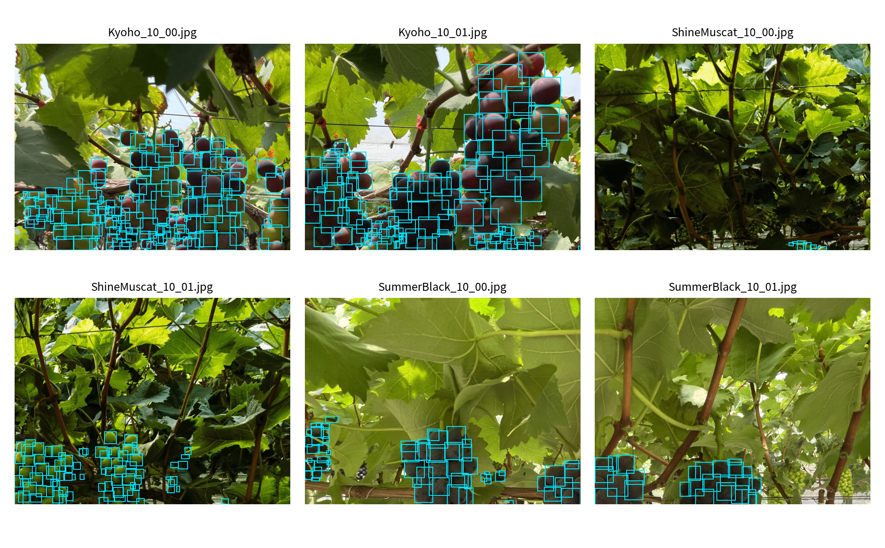

表2 三品种原图划分与固定阈值测试

| 品种 | 训练 验证 测试原图 | 测试F1 |
| --- | --- | --- |
| 巨峰 | 30 10 10 | 0.7266 |
| 阳光玫瑰 | 30 10 10 | 0.7601 |
| 夏黑 | 30 10 10 | 0.7590 |

# 2.1 花序训练样本

花序模型包含整花序与小穗两类。下图保留实际文件名，分别显示不同穗型、背景与视角的标注。清洗后按拍摄序号分组，原包的重复文件和已有旋转增强不参与独立原图计数。

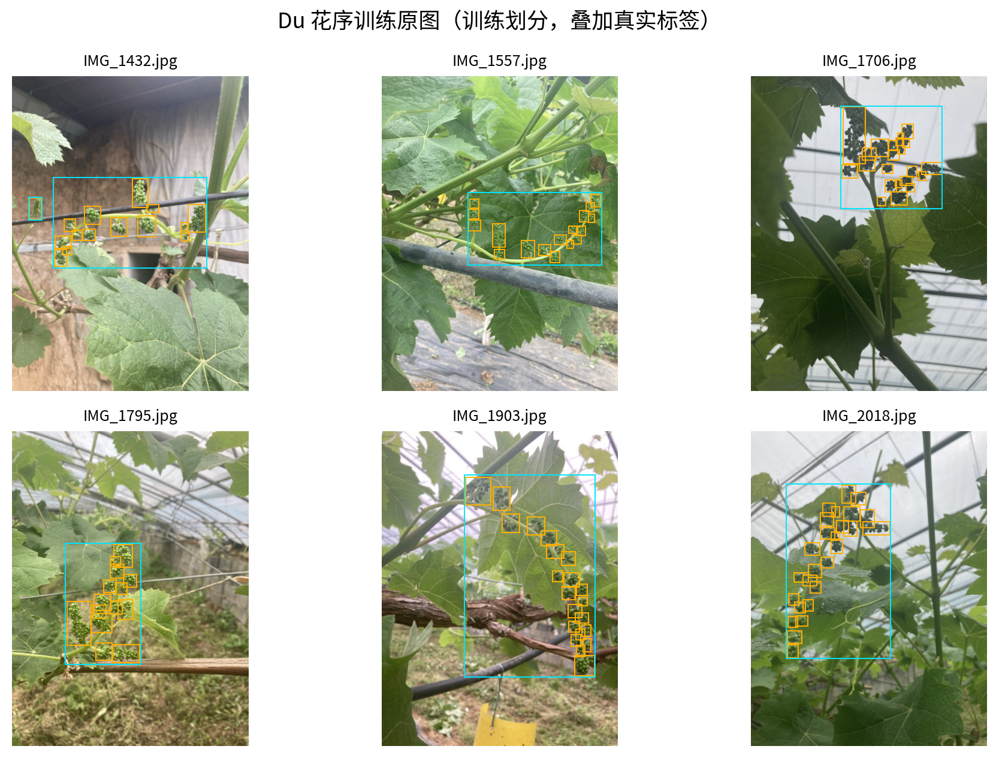

# 2.2 预处理与幼果适配

表3 实际划分与标签性质

| 数据 | 训练 | 验证 | 测试 | 标签 |
| --- | --- | --- | --- | --- |
| 辅助果粒 | 360图块 | 120图块 | 120图块 | 原实例框 |
| 花序 | 369图 | 75图 | 79图 | 花序及小穗框 |
| 幼果 | 37图 | 1区域 | 2区域 | 训练伪标签 评测视觉框 |

辅助果粒图块对应90/30/30张原图。裁切目标保留规则为可见框面积不少于原框65%，最长边缩至768像素。花序组号为拍摄编号整除10，以20261010随机种子打乱组号后按组划分。逐组样本数见reports/split_group_distribution.json。来源未提供植株、果园身份，编号相邻分组和去重只能控制已知泄漏风险，不能证明植株或场景完全独立。

幼果从网络候选中按品种配文及疏果阶段筛出37张真实照片[7]，辅助模型生成1571个伪标签。同一网页处理前后图全部留在训练侧；验证与测试分别来自另外两个网站[5,8]。评测区域由AI视觉辅助逐框检查，不使用待测模型预测直接充当真值。未获明确再分发许可的幼果照片不包含于公开包，对应逐图标注与来源定位清单也不公开。公开包可核查权重与汇总结果，不能独立重新训练幼果模型；来源网页可能失效。标签未进行双人一致性评估或专家复核。

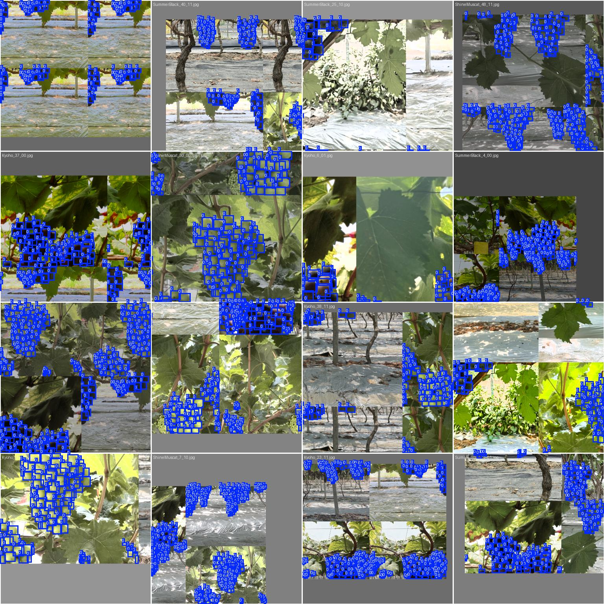

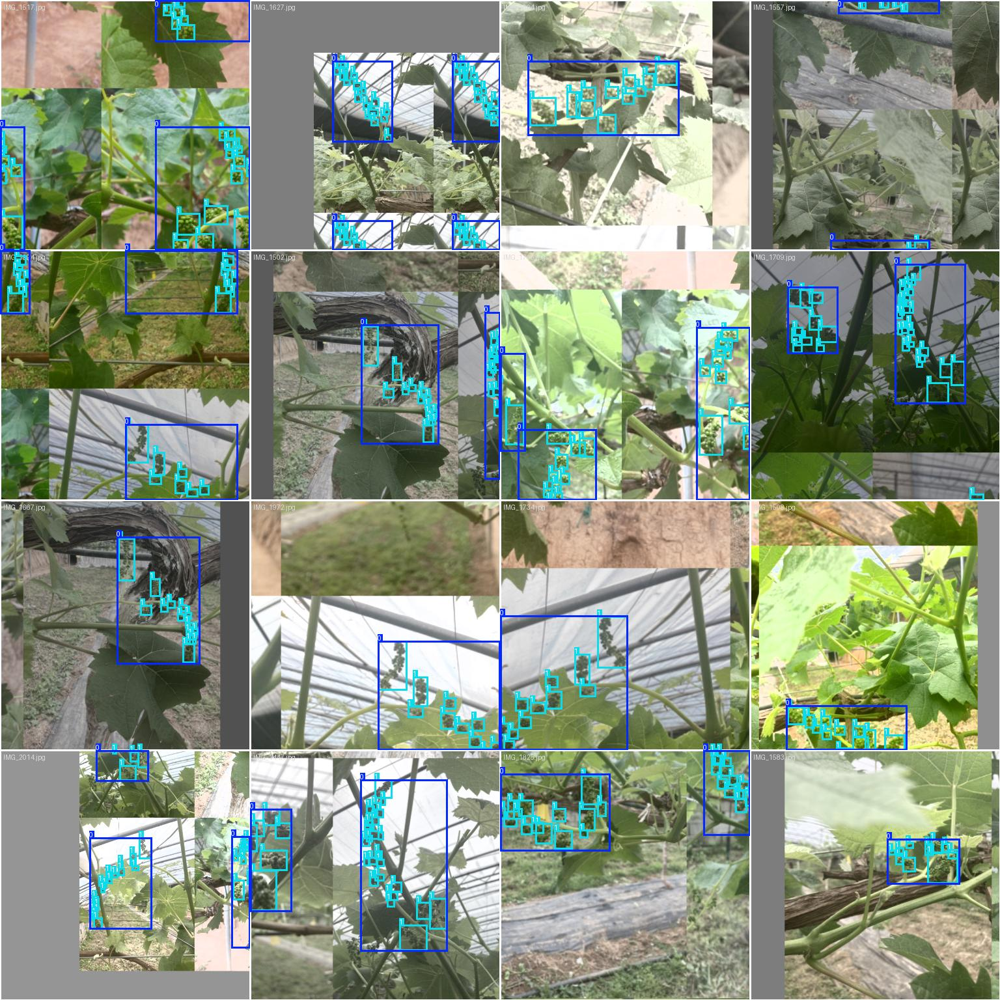

批次图由训练器实际保存，展示缩放、拼接等数据增强。它是训练过程证据，不是独立测试结果；幼果同样存在伪标签噪声，不能据此宣称已完成专家标注。

# 3 算法结构与设计程序

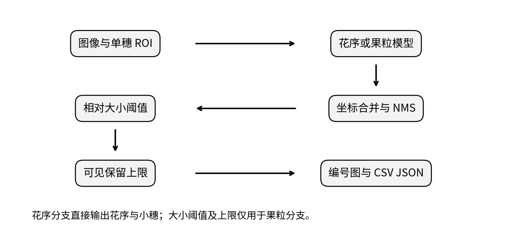

输入图像先由用户框选单穗。大区域使用1024像素窗口和768像素步长，坐标回到原图后以NMS消除重复框。模型输入固定填充到384像素，避免单图与批量填充方式不同造成计数差异。花序分支用于定位整花序、统计小穗及保存框坐标，不自动决定疏花或疏小穗；其计数不换算成果粒数，也不与果粒去除动作相加。果粒分支才继续执行尺度筛选。

第i个检测框宽高为wᵢ、hᵢ，投影尺度dᵢ=√(wᵢhᵢ)，相对尺度rᵢ=dᵢ/median(d)。当rᵢ<τ时建议去除，默认τ=0.70。它衡量二维框大小，透视与遮挡会影响判断，不能视作真实直径。

若设置可见保留上限K，则在大小筛选后，从中心距离除以平均尺度最小的一对中优先去除较小者，迭代至数量不超过K。数量满足N_total=N_keep+N_remove，分别表示检测总数、保留数和建议去除数，不推算漏检或遮挡对象。每粒保存编号、位置、尺度、动作和原因供人工复查。

# 3.1 原始模型训练配置

表4 各模型独立训练配置

| 参数 | 辅助果粒 | 花序与小穗 | 幼果适配 |
| --- | --- | --- | --- |
| 初始权重 | COCO YOLOv8n | COCO YOLOv8n | 辅助 best.pt |
| 轮次 | 25 | 25 | 25 |
| 输入边长 px | 384 | 384 | 384 |
| 批量 | 16 | 16 | 8 |
| 设备 | cpu | cpu | cpu |
| 优化器 | AdamW | AdamW | AdamW |
| 初始学习率 | 0.001 | 0.001 | 0.0003 |
| 冻结层数 | 10 | 10 | 10 |
| 随机种子 | 20261010 | 20261010 | 20261010 |

原训练日志记录Python 3.12.14、PyTorch 2.14.1+cpu、Ultralytics 8.4.175。依赖已固定在requirements.txt，补充的完整CPU依赖锁定文件为requirements-lock-cpu.txt。原主实验各只有一个随机种子；本轮追加每模型三个种子复验，配置和结果单独报告。

# 4 辅助果粒模型训练结果

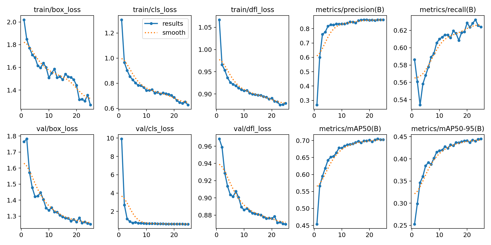

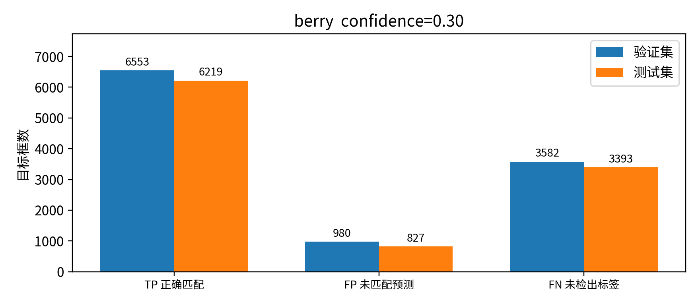

该模型学习较大果粒，稠密场景仍存在漏检。验证曲线不能代替幼果性能，也不能作为独立测试结论。

results.png来自保存的训练CSV，保留原训练器AP口径（NMS IoU=0.70，最多300框），不用于工作阈值比较。下方图按已保存预测重新匹配：IoU≥0.50，每类置信度仅由验证集选定并固定用于测试。TP为一对一正确匹配，FP为未匹配预测，FN为未检出标签；没有背景真阴性。原保存的conf=0.001、匹配IoU=0.45验证矩阵仅作过程档案，其未匹配预测数不能解释成背景标签数，也不能与工作阈值图直接比较。

# 4.1 花序与小穗模型训练结果

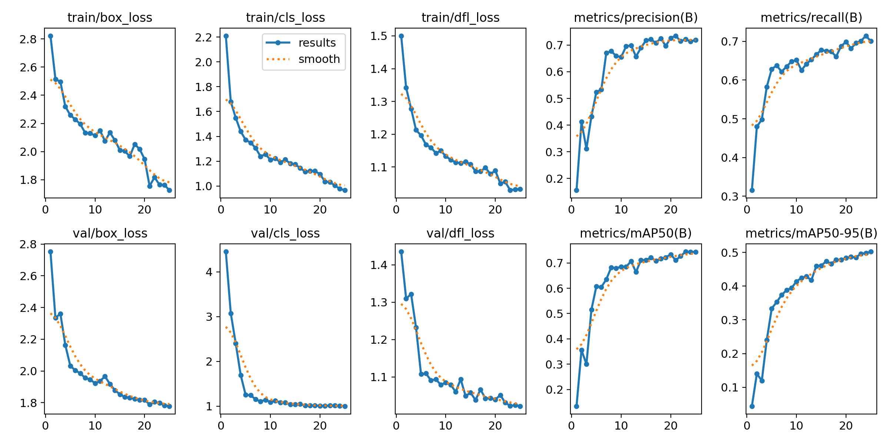

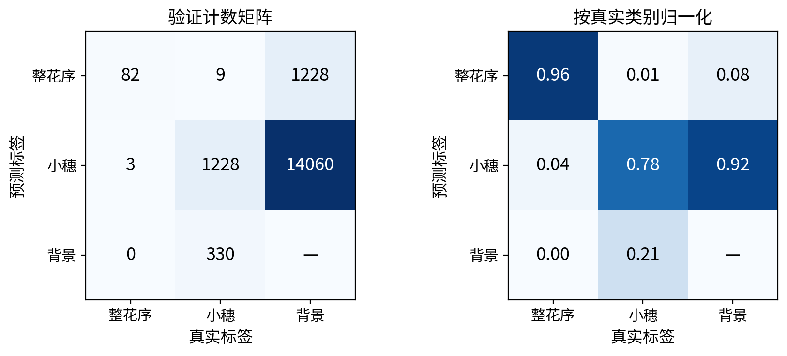

整花序尺度较大，定位较容易；小穗密集且相似，定位与类别混淆更明显。spikelet指小穗，不能当作单花。

results.png来自保存的训练CSV，保留原训练器AP口径（NMS IoU=0.70，最多300框），不用于工作阈值比较。下方图按已保存预测重新匹配：IoU≥0.50，每类置信度仅由验证集选定并固定用于测试。TP为一对一正确匹配，FP为未匹配预测，FN为未检出标签；没有背景真阴性。原保存的conf=0.001、匹配IoU=0.45验证矩阵仅作过程档案，其未匹配预测数不能解释成背景标签数，也不能与工作阈值图直接比较。

# 4.2 幼果弱标注模型训练结果

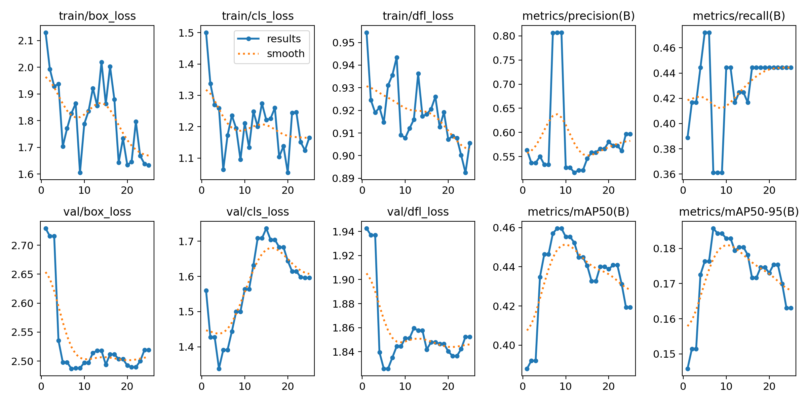

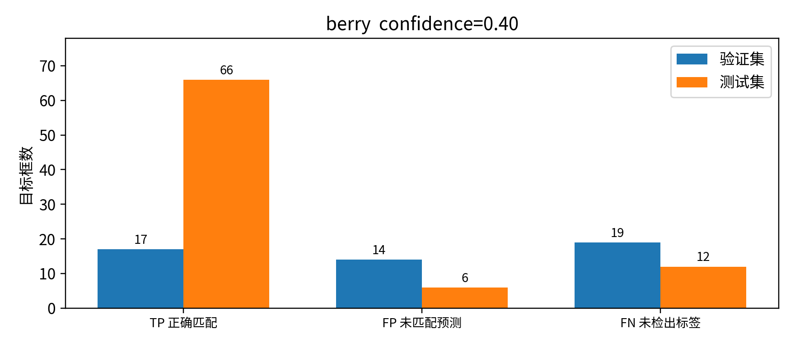

训练37张、验证仅1个区域，因此曲线波动和较高分数缺乏稳健性。验证标签未经专家复核，不能报告为普遍识别准确率。

results.png来自保存的训练CSV，保留原训练器AP口径（NMS IoU=0.70，最多300框），不用于工作阈值比较。下方图按已保存预测重新匹配：IoU≥0.50，每类置信度仅由验证集选定并固定用于测试。TP为一对一正确匹配，FP为未匹配预测，FN为未检出标签；没有背景真阴性。原保存的conf=0.001、匹配IoU=0.45验证矩阵仅作过程档案，其未匹配预测数不能解释成背景标签数，也不能与工作阈值图直接比较。

# 5 独立测试结果与计数误差

预测按置信度排序，以IoU≥0.50逐框匹配，每个真实框最多匹配一次。阈值仅由验证集候选值的最高F1选定，再用于测试；P、R、F1与AP分别记录。图11仅列TP、FP、FN，不设真实背景类别或真阴性格。固定阈值F1=2TP/(2TP+FP+FN)，与AP曲线积分不是同一个量。

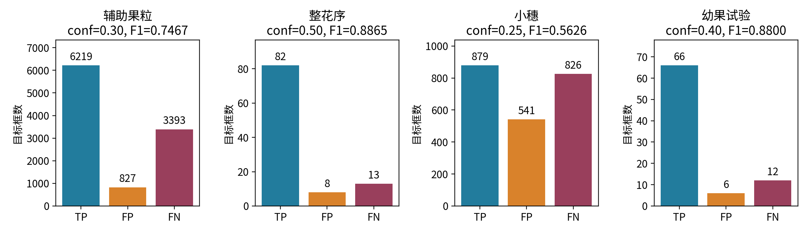

表5 固定阈值测试结果

| 对象 | 图数 | 阈值 | P | R | F1 | MAE |
| --- | --- | --- | --- | --- | --- | --- |
| 辅助果粒 | 120 | 0.30 | 0.883 | 0.647 | 0.7467 | 21.72 |
| 整花序 | 79 | 0.50 | 0.911 | 0.863 | 0.8865 | 0.14 |
| 小穗 | 79 | 0.25 | 0.619 | 0.516 | 0.5626 | 5.56 |
| 幼果试验 | 2 | 0.40 | 0.917 | 0.846 | 0.8800 | 3.00 |

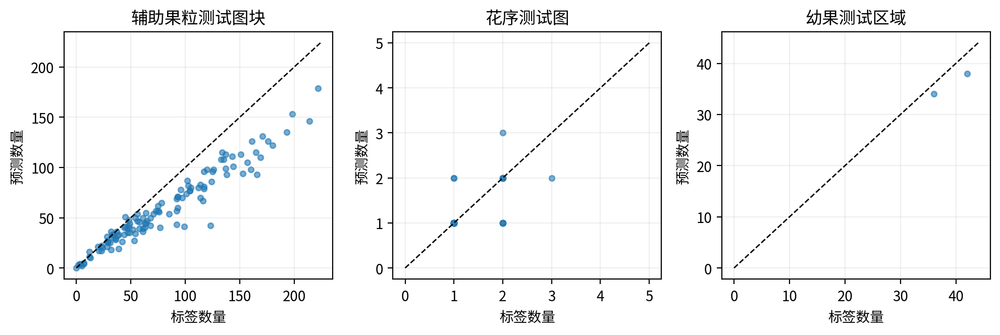

MAE单位：辅助果粒为粒每图块；整花序为穗每图；小穗为小穗每图；幼果为粒每区域。辅助120图块对应30原图，不能将图块MAE称为每原图或每果穗误差。幼果只有2区域，其结果仅为流程试验。

# 5.1 PR曲线与适配对照

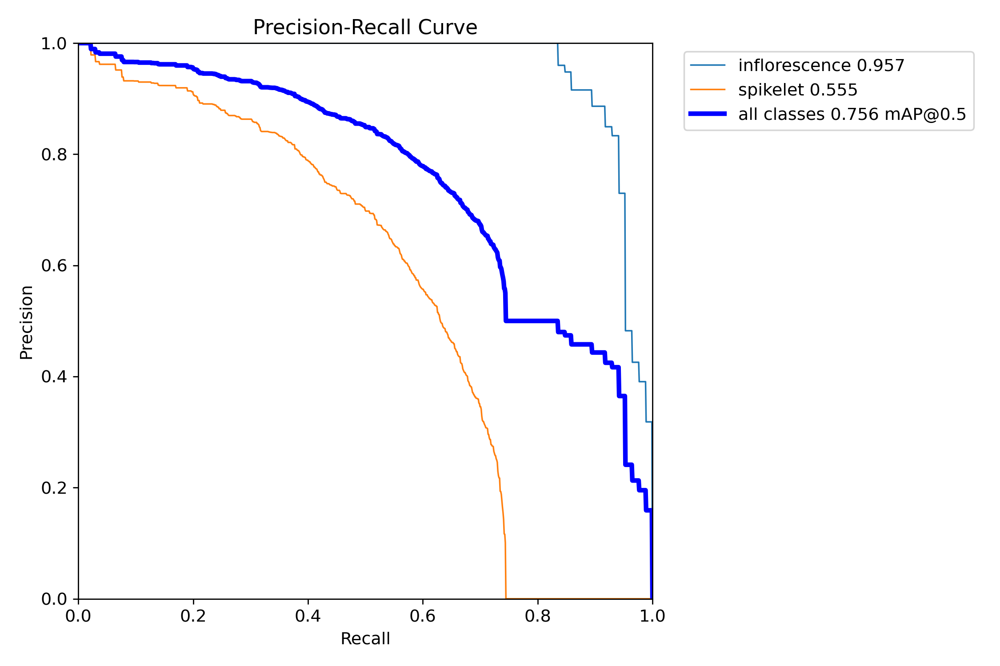

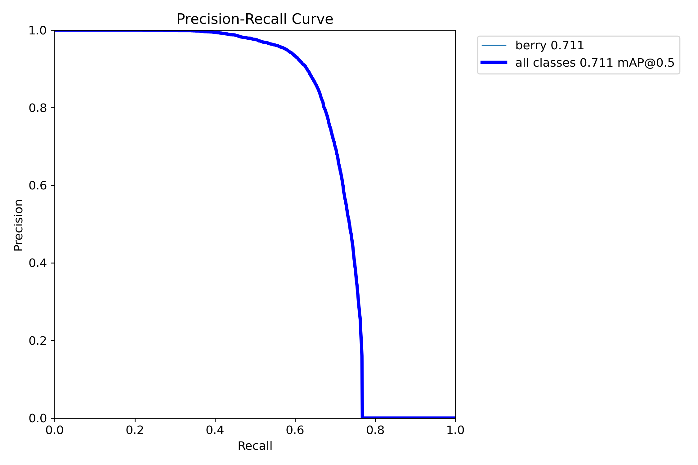

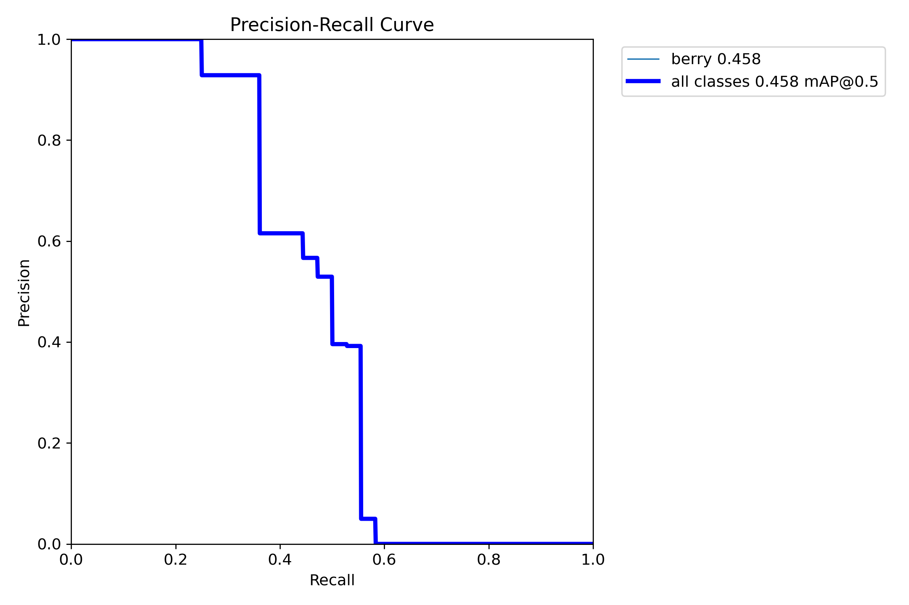

表6 同一幼果测试区域的同阈值对照

| 模型 | 共同阈值 | F1 | MAE 粒每区域 |
| --- | --- | --- | --- |
| 辅助直接预测 | 0.30 | 0.7953 | 7.50 |
| 弱标注适配 | 0.30 | 0.8395 | 3.00 |
| 辅助直接预测 | 0.40 | 0.8293 | 5.00 |
| 弱标注适配 | 0.40 | 0.8800 | 3.00 |
| 辅助直接预测 | 0.50 | 0.8645 | 4.50 |
| 弱标注适配 | 0.50 | 0.8671 | 6.50 |

同阈值0.40下适配模型的MAE较小；0.50下反而更大，不能笼统声称适配全面改善。测试仅2区域且来自同一来源，标签未经专家复核，不进行总体显著性检验。原分别选阈值的比较保留在原始记录中，不作为因果改善证据。

# 6 程序输入与实际输出

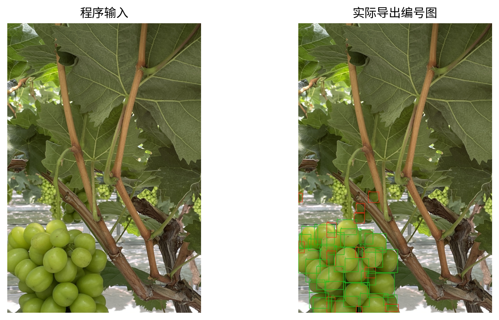

果粒命令行入口为src/predict.py，绿色框为保留，红色框为建议去除。所有数量只覆盖检测到的可见对象。多穗照片应先框选单穗，否则统计的是整个输入区域。

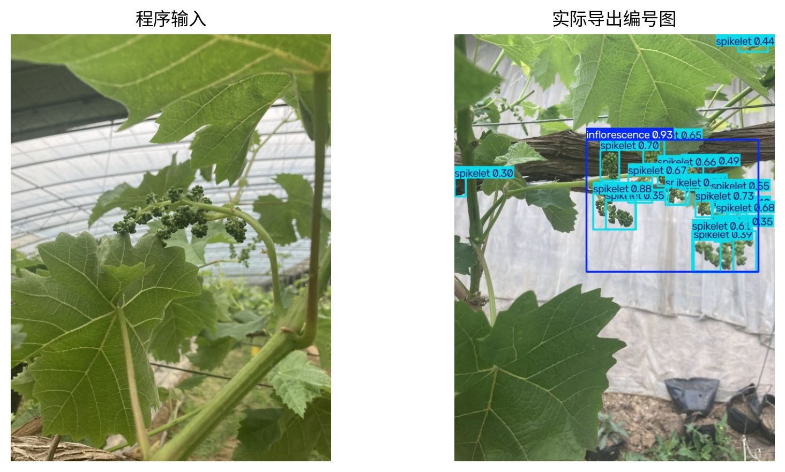

花序入口为src/flower_predict.py，整花序与小穗计数分别输出。本页来自实际导出的annotated.jpg，展示花序分支的功能。

# 6.1 运行记录与结构化导出

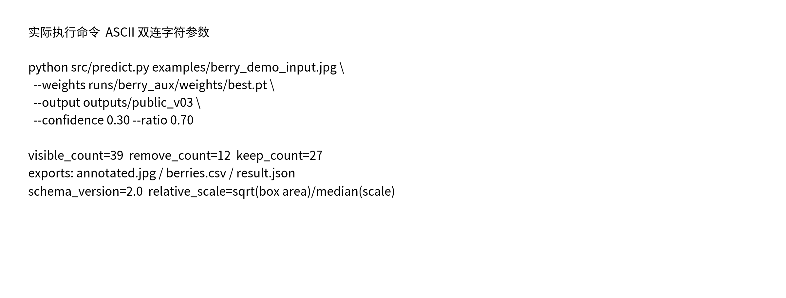

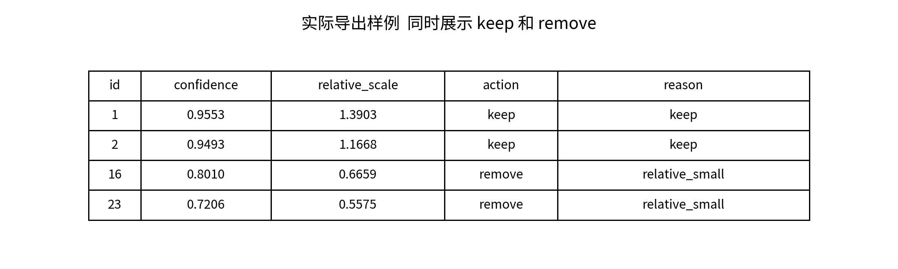

导出目录同时包含annotated.jpg、berries.csv和result.json。CSV使用UTF-8 BOM。修订schema_version为2.0，将relative_diameter改名为relative_scale；该值是相对投影尺度，不是真实直径。JSON记录ROI、模型、阈值、耗时和逐粒决策；旧版记录保留旧字段作为历史档案。图17与图18由保存的真实记录导出，属于命令行与结构化输出的运行证据。

桌面入口src/app.py提供打开照片、拖框选ROI、切换模型和参数输入，推理线程异步回传结果。当前环境无法建立图形服务连接，尚未完成窗口交互验收，窗口操作仍需在目标电脑验收。已实际验证的入口是命令行。

# 7 阈值响应与失败样例

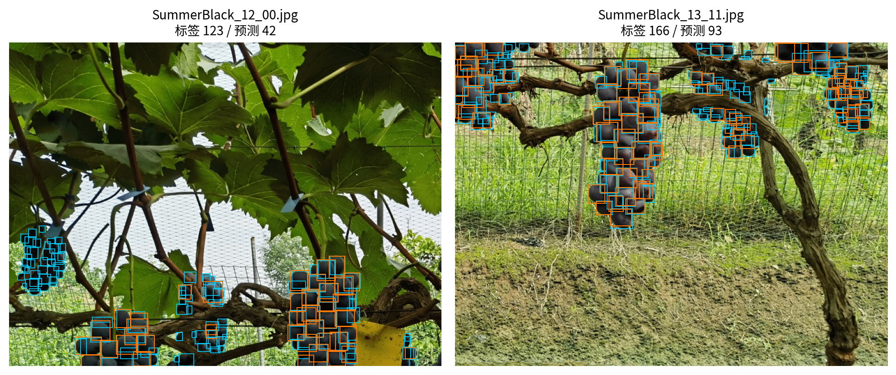

失败图主动选取绝对计数误差最大的测试样本，避免只展示好看的结果。密集果粒在384像素输入下目标很小，遮挡导致漏检，叶片及果梗也可能产生误检；提高小果比例阈值不会修复检测漏检。

表7 同一40粒演示ROI的小果比例敏感性

| 比例τ | 检测数 | 建议去除 | 保留 |
| --- | --- | --- | --- |
| 0.50 | 40 | 3 | 37 |
| 0.60 | 40 | 7 | 33 |
| 0.70 | 40 | 15 | 25 |
| 0.80 | 40 | 17 | 23 |
| 0.90 | 40 | 19 | 21 |

默认0.70下建议去除15粒、保留25粒。该表只验证规则响应与数量守恒，未与农艺专家疏除选择对照，不能据此称默认比例最优。原版工程验收通过6项单元测试及真实照片导出、中文路径、空白图像、缺失文件、越界ROI和CSV/JSON一致性检查。

# 7.1 选择性漏检与规则敏感性

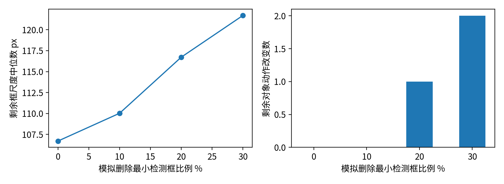

在保存的40框示例上模拟删除最小的10%、20%、30%检测框，中位尺度由106.70 px增至110.02、116.72、121.71 px；剩余对象建议分别改变0、1、2个。这是检测结果上的扰动分析，不是新检测性能实验。中位数归一化也会受选择性漏检影响；分位数或空间分层需另行验证，当前建议必须由人工复查。

# 7.2 指标不确定性与AP评估

表8 按编号组重采样的条件百分位区间

| 对象 | 组数 | F1 95%区间 | MAE 95%区间 |
| --- | --- | --- | --- |
| 辅助果粒 | 6 | 0.7269 至 0.7707 | 13.72 至 27.82 |
| 整花序 | 9 | 0.8148 至 0.9554 | 0.08 至 0.20 |
| 小穗 | 9 | 0.5385 至 0.5885 | 4.85 至 6.27 |

重采样10000次，随机种子20261012；辅助按连续5张原图组，花序按编号整除10组。区间以标签和当前模型为条件，并假设编号组独立；来源缺少植株身份，不能据此证明场景独立。重采样不能替代多种子重训，也不覆盖标注偏差。幼果只有两个同来源区域，不给出具有总体解释的置信区间。

表9 独立测试AP与固定阈值指标分开报告

| 对象 | AP50 | AP50至95 |
| --- | --- | --- |
| berry_aux berry | 0.7148 | 0.4505 |
| flower inflorescence | 0.9293 | 0.6486 |
| flower spikelet | 0.5166 | 0.2149 |
| 幼果 流程试验 | 0.8741 | 0.4189 |

三组AP均已以原主实验权重重新验证，并与原记录一致；本轮重复训练另列。AP50匹配IoU为0.50；AP50至95为IoU 0.50至0.95步长0.05的平均。AP评测候选置信度下限0.001、NMS IoU 0.50，不能把该下限称作固定工作阈值。

# 7.3 三种随机种子重复训练

固定原有数据划分，分别用20261010、20261012、20261013三个种子追加训练，每次25轮，共9次。辅助果粒和花序从同一COCO预训练权重开始；幼果均从原主实验辅助best.pt开始，不按辅助复验的测试表现选择初始模型。冻结层数、优化器、学习率与输入大小沿用原配置；本轮固定8线程、workers=0、patience=25，保持实际训练轮数一致。

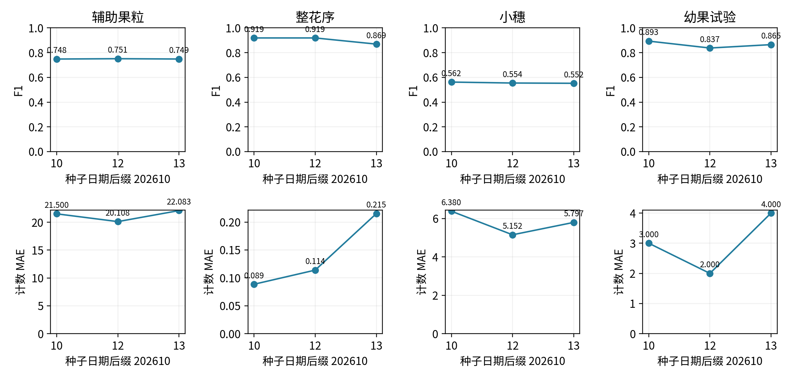

表10 三次训练的均值和样本标准差

| 对象 | F1 | 计数MAE | MAE单位 |
| --- | --- | --- | --- |
| 辅助果粒 | 0.7493 ± 0.0015 | 21.23 ± 1.01 | 粒每图块 |
| 整花序 | 0.9023 ± 0.0288 | 0.14 ± 0.07 | 穗每图 |
| 小穗 | 0.5563 ± 0.0051 | 5.78 ± 0.61 | 小穗每图 |
| 幼果试验 | 0.8652 ± 0.0279 | 3.00 ± 1.00 | 粒每区域 |

每次最佳轮次及工作阈值仅由验证集选择，再固定到测试；全部种子均报告。完整逐次指标、AP和阈值见reports/seed_repeats.json，权重、配置与25轮CSV见runs/repeats。标准差仅表示当前固定划分和标签条件下的训练波动，不是跨果园泛化区间。幼果验证仅1区、测试仅2区；三次重训没有增加独立测试样本，也不能减轻弱标签偏差。当前硬件及workers与原主实验有差异，因此原主实验与本轮种子复验分别列示，不用新值覆盖旧值。

三种子测试mAP50 / mAP50至95的均值±标准差：辅助果粒 0.7150±0.0005 / 0.4508±0.0013；花序两类平均 0.7218±0.0082 / 0.4423±0.0108；幼果试验 0.8711±0.0118 / 0.4228±0.0173。花序值为两类平均，不是单独小穗的AP。

# 7.4 运行测量和导出字段

表11 当前CPU预热推理测量

| 模型 | 批量 | ms每图 | 图每秒 | 峰值RSS MiB |
| --- | --- | --- | --- | --- |
| berry_aux | 1 | 16.21 | 61.7 | 470.2 |
| berry_aux | 4 | 10.22 | 97.9 | 512.3 |
| flower | 1 | 16.53 | 60.5 | 512.3 |
| flower | 4 | 11.21 | 89.2 | 512.3 |
| young | 1 | 17.74 | 56.4 | 512.3 |
| young | 4 | 11.09 | 90.2 | 527.8 |

硬件为INTEL(R) XEON(R) PLATINUM 8573C，固定8线程、384像素方形填充。预热3次后测20次；同一已解码许可图重复输入，包含预处理、前向与NMS，不包含模型加载、磁盘读取、ROI切窗和结果导出。吞吐量不是交互界面的端到端FPS，峰值RSS为进程累计峰值，不是独立模型内存。原训练硬件为AMD EPYC 9V74，不能与当前测量混同。原始时间序列与标准差见reports/cpu_benchmark.json。

表12 CSV及JSON逐粒字段

| 字段 | 含义和取值 |
| --- | --- |
| id | 当前结果内从1开始的编号 对应编号图 不保证跨图一致 |
| box | 原图像素坐标 x1 y1 x2 y2 |
| confidence | 检测置信度 0至1 不表示农艺正确概率 |
| relative_scale | sqrt(框面积)除以当前检测框尺度中位数 无量纲 |
| action | keep 保留 或 remove 建议去除 |
| reason | keep 未触发规则 relative_small 低于尺度阈值 crowding_target 因可见上限去除 |

只有设置visible_target时才使用crowding_target；花序分支仅输出定位与类别计数，不输出果粒去除动作。8项单元测试通过；新版CLI实测39个检测对象，建议去除12、保留27，字段与编号图可对应。

# 8 结论与交付复现

本设计完成三组实际训练及可见目标识别、相对大小筛选、可调上限和结构化导出。训练数据、曲线、混淆矩阵与失败案例均保留来源路径，便于检查“样本—训练—验证—测试—程序输出”的对应关系。当前可作为课程算法原型，尚无整穗隐藏粒数、田间疏除正确率或机械剪切精度的证据。

后续应优先扩大跨果园、跨光照的独立幼果样本，并由双人或专家复核标签，再考虑实例分割与果梗朝向。继续追求更高小样本分数不足以消除上述限制。

表13 交付包可直接查找的材料

| 目录 | 内容 |
| --- | --- |
| data/berry_yolo images labels | 实际辅助果粒训练360 验证120 测试120图块 |
| data/flower_yolo images labels | 实际花序训练369 验证75 测试79原图 |
| 幼果模型与汇总记录 | 公开包不包含幼果原图及逐图标注 无法仅依公开包重训 |
| runs 各模型目录 | best last权重 results.csv results.png 矩阵 PR |
| docs figures | 论文图及图像来源证据索引 |
| src scripts tests reports | 程序 复现脚本 单元测试 实际评测与日志 |

完整包解压后先按使用说明安装依赖，再运行提供的两张有许可的示例；模型已训练，无需重训才能识别。幼果网络来源可能失效，公开包也不包含对应原图和逐图标注，其复现只能核查汇总记录及已训练权重。更换路径后运行scripts/relink_datasets.py。本轮已补充9次多随机种子训练和CPU测量；双人或专家复核、田间验证和桌面窗口交互验收仍未完成。

# 参考文献

[1] YANG C, GENG T, PENG J, et al. Mask-GK An efficient method based on mask Gaussian kernel for segmentation and counting of grape berries in field[J]. Computers and Electronics in Agriculture, 2025, 234:110286. DOI:10.1016/j.compag.2025.110286.

[2] DU W, QIN W, CUI X, et al. A precise berry counting method for in-cluster grapes to guide berry thinning[J]. Frontiers in Plant Science, 2026,16:1739688. DOI:10.3389/fpls.2025.1739688. 本设计未取得其完整779张数据.

[3] ULTRALYTICS. Explore Ultralytics YOLOv8[EB/OL]. https://docs.ultralytics.com/models/yolov8. 访问日期2026-10-10.

[4] 上海市人民政府新闻办公室. 精品果按串销售每串售价100元 马陆葡萄品牌价值再创新高[EB/OL]. https://www.shio.gov.cn/TrueCMS/shxwbgs/ywts/content/94f32927-3c25-4f87-82c2-1cf6438d6cc2.htm. 访问日期2026-10-10.

[5] やくも果樹研究所. シャインマスカット栽培 摘房 摘粒 1回目[EB/OL]. https://kaju-fruits.com/シャインマスカット　粗摘房・粗摘粒/. 访问日期2026-10-10.

[6] DU W. Grape inflorescence dataset[DB/OL]. Mendeley Data,2022,V1. DOI:10.17632/skwbr5k9gg.1. CC BY 4.0.

[7] Tom. シャインマスカットのジベレリン処理後の予備摘粒[EB/OL]. https://tomtom1ono.hatenablog.com/entry/2026/06/19/225730. 2026-06-19.

[8] Grapetopia. 粒間引き 摘粒 荒間引き[EB/OL]. https://grapetopia.hatenablog.com/entry/2020/06/06/222016. 2020-06-06.

[9] DOMINGOS S, SCAFIDI P, CARDOSO V, et al. Flower abscission in Vitis vinifera L. triggered by gibberellic acid and shade discloses differences in the underlying metabolic pathways[J]. Frontiers in Plant Science, 2015,6:457. DOI:10.3389/fpls.2015.00457.